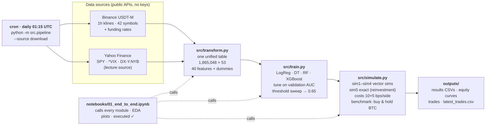

# Hourly Crypto Algo-Trading — Binance perps × Yahoo macro


**An end-to-end machine-learning trading project** built for the
[Stock Market Analytics Zoomcamp 2026](https://github.com/DataTalksClub/stock-markets-analytics-zoomcamp):
predict the next-24-hour direction of **42 crypto perpetuals from hourly
candles**, turn the probabilities into portfolios, and simulate them with real
trading costs — including an exact iterative simulation with reinvestment.

---

## Results at a glance

**Test set (2025-07-01 → 2026-11-15) — a bear market where buy-and-hold BTC
lost −37.4%:**

| Strategy                                   | Total return      | CAGR              | Sharpe           | Max DD            |
| ------------------------------------------ | ----------------- | ----------------- | ---------------- | ----------------- |
| **sim3 long/short (new strategy)**   | **+48.5%**  | **+33.4%**  | **0.77**   | −43.3%           |
| sim5 exact · no-regime ablation           | +18.8%            | +13.4%            | 0.57             | −37.6%           |
| sim1 long-only (daily)                     | +12.5%            | +8.9%             | 0.44             | −38.3%           |
| sim2 proba-sized (daily)                   | +12.5%            | +8.9%             | 0.44             | −38.3%           |
| sim4 top-5 proba (daily, vector)           | +8.8%             | +6.3%             | 0.36             | −38.2%           |
| sim5 exact · valid-selected regime filter | −11.0%           | −8.1%            | −0.16           | −37.6%           |
| **benchmark: buy & hold BTC**        | **−37.4%** | **−28.9%** | **−0.63** | **−53.8%** |

**Validation set (2024-07 → 2025-07, a bull window, BTC +70.2%):** the exact
simulation with the validation-selected config returned **+85.6% (Sharpe 1.63)**
vs BTC's +70.2% (Sharpe 1.30); the other long-only variants matched or beat
the benchmark as well.

> **Takeaway:** every long-only variant beats the benchmark by ~46–50
> percentage points and the long/short variant by ~86 points out-of-sample —
> while the one config that was *tuned* on validation (vol-regime filter)
> failed on test. Section [6](#6-key-findings--debugging-things-that-went-wrong-and-why) documents both,
> including what went wrong and why.

**How to read these numbers:** *Total return* = growth of $1 over the window.
*CAGR* = annualized return. *Sharpe* = annualized return ÷ volatility
(>1 is good, >2 is excellent). *Max DD* = worst peak-to-trough loss (more
negative = riskier). *Precision* = share of predicted signals that were
correct. *Signal share* = share of hours with a signal (our threshold rule
keeps it ≥2%).

---

## Table of contents

- [What is this?](#what-is-this)
- [Quick start](#quick-start)
- [Architecture](#architecture)
- [1. Problem statement](#1-problem-statement)
- [2. Data sources](#2-data-sources)
- [3. Dataset &amp; features](#3-dataset--features-40-numeric--2-dummy-sets)
- [4. Modeling](#4-modeling)
- [5. Strategies &amp; results](#5-strategies--results-all-costs--10-bps-fee--5-bps-slippage-per-side)
- [6. Key findings &amp; debugging](#6-key-findings--debugging-things-that-went-wrong-and-why)
- [7. Repository layout](#7-repository-layout)
- [8. Reproducing, automation &amp; Docker](#8-reproducing-automation--docker)
- [9. Rubric mapping](#9-rubric-mapping)

## What is this?

In plain terms: the project **watches 42 coins every hour, guesses which ones
will be up 24 hours later, and trades those guesses with pretend money while
charging itself real fees.** Concretely:

1. **Download** 6 years of hourly candles + funding rates from Binance's
   public API and daily macro indicators (S&P 500, VIX, Dollar Index) from
   Yahoo Finance — no API keys needed.
2. **Transform** everything into one big table (1,865,048 rows × 53 columns)
   with 40 engineered features (returns, volatility, RSI, funding, beta to
   BTC, …).
3. **Train** four classifiers (Logistic Regression, Decision Tree, Random
   Forest, XGBoost) to predict “will this coin be up in 24h?”, tune them on a
   validation window, and pick a probability threshold that maximizes
   precision.
4. **Simulate** five trading strategies day-by-day with 15 bps of round-trip
   costs — 4 fast vectorized simulations plus 1 *exact* simulation that tracks
   actual positions, cash and reinvested gains — and compare everything
   against simply holding BTC.
5. **Automate**: one notebook calls every Python module end-to-end; a cron
   job can re-run the whole thing daily and emit a fresh trade list.

## Quick start

```bash
cd projects/hourly-crypto
pip install -r requirements.txt

# FIRST run: pulls full history from the public APIs (~15–30 min, no keys)
python -m src.pipeline --source download

# LATER runs: offline from local files (~11 min: transform + train + sims)
python -m src.pipeline --source file

# or explore interactively — the notebook calls every module in src/
jupyter notebook notebooks/01_end_to_end.ipynb
```

After any run, the current trade list is in `outputs/latest_trades.csv`
(the newest hour's top-5 BUY signals; empty whenever no probability clears the
0.65 threshold, which happens ~40% of hours at a 2.1% signal share).

## Architecture



**Two operating modes** (course rubric requires both):

| Mode         | Command                                      | Behaviour                                                                                                  |
| ------------ | -------------------------------------------- | ---------------------------------------------------------------------------------------------------------- |
| *file*     | `python -m src.pipeline --source file`     | runs purely from local parquet files — fast, reproducible, zero API calls (grader/CI rerun)               |
| *download* | `python -m src.pipeline --source download` | first *incrementally* fetches only missing rows from Binance/Yahoo (resume-safe), then runs the workflow |

---

## 1. Problem statement

Crypto perps trade 24/7 with hourly candles, funding payments and heavy retail
flow — a setting where a *week-long daily strategy on a handful of large caps*
(the course default) leaves most of the intraday structure unused. We build the
full pipeline on **hourly bars for 42 coins over ~6 years (1.87M rows)**:

1. select data sources (Binance public REST + Yahoo Finance),
2. build one unified table (1.87M rows × 53 columns),
3. engineer 40 derived features + symbol/hour dummies,
4. train 4 models (LogReg, DecisionTree, RandomForest, XGBoost) to predict
   `target_24h = forward-24h return > 1.0`,
5. define **5 strategies** (4 vector + 1 exact with reinvestment) and simulate
   them against buy-and-hold BTC,
6. automate: one notebook calls all `.py` modules; cron-able daily pipeline
   with incremental API downloads.

## 2. Data sources

| Source                                                       | What                                                           | Records     | Notes                                                                                               |
| ------------------------------------------------------------ | -------------------------------------------------------------- | ----------- | --------------------------------------------------------------------------------------------------- |
| **Binance USDT-M futures REST** (`fapi.binance.com`) | 1h klines (OHLCV, trades, taker flow) for 42 pure-crypto perps | 1,865,048   | public, no key; incremental resume from last stored timestamp                                       |
| **Binance funding rates** (`/fapi/v1/fundingRate`)   | 8h (some 4h) funding events, full history since 2021           | ~252,000    | as-of merged onto the hourly grid                                                                   |
| **Yahoo Finance** (yfinance): SPY, ^VIX, DX-Y.NYB      | cross-asset risk regime (equity momentum, vol, dollar)         | 1,474 daily | lecture data source; published daily bars made available **D+1 00:00 UTC** to avoid lookahead |

Not used: Binance open-interest history (API only keeps ~30 days — verified
empirically, which is why funding rates carry the derivatives signal).

**Universe:** curated pure-crypto USDT perps (BTC…WIF). Tokenized-stock and
metal perps that Binance now lists (NVDAUSDT, XAUUSDT, …) are deliberately
excluded; 3 delisted candidates (TON/EOS/MKR) are filtered at download time.

## 3. Dataset & features (40 numeric + 2 dummy sets)

Splits (chronological, no shuffle — future never leaks into training):

| Split | Window             | Rows    |
| ----- | ------------------ | ------- |
| train | 2021-01 → 2024-06 | 965,141 |
| valid | 2024-07 → 2025-06 | 367,887 |
| test  | 2025-07 → 2026-11 | 505,512 |

Target class share ≈ 0.49 (balanced: half of coin-hours end 24h higher).

| Group                      | Features                                                                                    |
| -------------------------- | ------------------------------------------------------------------------------------------- |
| Returns / candle shape (6) | `ret_1h`, `ret_24h`, `ret_168h`, `hl_range`, `body`, `body_sign`                |
| Volume / flow (4)          | `vol_z24`, `taker_buy_ratio`, `vwap_dev_24`, `trades_z24`                           |
| Volatility (4)             | `rv_24`, `rv_168`, `vol_of_vol`, `ret_skew_24`                                      |
| Momentum (6)               | `rsi_14`, `rsi_48`, `macd_hist`, `dist_high_168`, `dist_low_168`, `price_z_168` |
| Calendar (5)               | `hour_sin/cos`, `dow_sin/cos`, `log_days_listed`                                      |
| Funding — new source (4)  | `funding_rate`, `funding_ma_24`, `funding_z_720`, `funding_pos`                     |
| Market factor = BTC (4)    | `mkt_ret_24h`, `btc_rv_24`, `corr_btc_168`, `beta_btc_168`                          |
| Cross-sectional (2)        | `xs_quote_share` (hourly volume share), `xs_ret_rank`                                   |
| Cross-asset macro (5)      | `spy_ret_5d`, `spy_ret_20d`, `vix_log`, `vix_chg_5d`, `dxy_ret_10d`               |
| Dummies (2 sets)           | `symbol` (42), `hour_bucket` (4×6h)                                                    |

Also present: raw OHLCV + `btc_rv_24` (used by the regime filter).

Feature formulas live in `src/transform.py::NUMERIC_FEATURES` — the single
source of truth used by training and the notebook.

## 4. Modeling

- **Models:** LogisticRegression (scaled numerics), DecisionTree,
  RandomForest(100), XGBoost(300) — all with small manual hyper-parameter
  grids chosen by **validation ROC-AUC** (test never touched).
- **Custom decision rule:** probability-threshold sweep on validation —
  maximize precision subject to ≥2% of rows being signals
  (`outputs/threshold_sweep.csv`).
- **Chosen model:** RandomForest `max_depth=13, min_samples_leaf=50`,
  threshold **0.65** → test **precision 59.9%** at 2.1% signal share
  (base rate 48.6%), test AUC 0.529.

| model        | val AUC         | test AUC        | thr            | test precision  |
| ------------ | --------------- | --------------- | -------------- | --------------- |
| logreg       | 0.507           | 0.512           | 0.50           | 48.5%           |
| dt           | 0.515           | 0.507           | 0.67           | 47.0%           |
| **rf** | **0.524** | **0.529** | **0.65** | **60.0%** |
| xgb          | 0.524           | 0.525           | 0.80           | 54.5%           |

## 5. Strategies & results (all costs = 10 bps fee + 5 bps slippage per side)

Signals decided at hour *t* are executed at the close of *t+1* (1-hour shift,
so the decision can never use the price it trades at).

- **sim1_rf_long** (vector): decide at 00:00 UTC, equal-weight all signals,
  hold 24h.
- **sim2_rf_probasize** (vector): same, but weight = model probability.
- **sim3_rf_longs** (vector, *new strategy*): dollar-neutral long/short —
  long top signals, short `prob ≤ 1−thr` signals.
- **sim4_rf_advanced** (vector): top-5 concurrent, proba-normalized weights.
- **sim5_rf_exact** (*exact simulation*): iterative hourly loop with actual
  positions, cash accounting, **reinvestment of capital gains**, efficient
  capital utilisation (weights always sum to 1 among ≤5 positions), daily
  rebalance to targets, hourly stop-loss / max-hold / vol-regime options.
  The optional config (`stop_loss`, `max_hold`, `regime_min`) is selected on
  the **validation** set only (`outputs/strategy_config.json`).

### Validation (bull, BTC +70.2%)

|                                              | total            | Sharpe         |
| -------------------------------------------- | ---------------- | -------------- |
| sim1                                         | +70.3%           | 1.27           |
| sim2                                         | +70.6%           | 1.28           |
| sim3                                         | +3.5%            | 0.44           |
| sim4                                         | +85.1%           | 1.43           |
| **sim5 (selected: vol-regime filter)** | **+85.6%** | **1.63** |
| benchmark BTC                                | +70.2%           | 1.30           |

### Test (bear, BTC −37.4%)

See the [headline table](#results-at-a-glance) at the top. Every strategy
except the validation-selected sim5 beats the benchmark; sim3 (long/short) is
the standout at **+48.5%**.

## 6. Key findings & debugging (things that went wrong and why)

1. **Fee churn destroyed v1.** The signal itself was always positive-EV
   (+0.57% mean forward-24h per signal, +0.27% after costs) but the first
   hourly-rebalanced simulation *lost 59%*: re-weighting an ~8-position
   portfolio every hour generated ~968 full-equivalent rebalances → **1.45 of
   fees vs 0.63 of gross PnL**. Fix: decide once a day (00:00) and hold 24h.
   This single change moved the same signal from −48% CAGR to +19% (valid).
2. **Target leakage** of `growth_future_72h` into the feature list was caught
   by a NaN crash in LogisticRegression (forward columns now hard-excluded).
3. **Yahoo daily-bar lookahead:** daily bars stamped day *D* are only known
   after the US close (~21:00 UTC); as-of merging at 00:00 injected ~21h of
   lookahead and inflated validation returns to +132%. Fixed by making macro
   data available from **D+1 00:00 UTC** — all reported numbers are post-fix.
4. **Validation→test decay:** RF validation precision 76.6% fell to ~55–60%
   out-of-sample (threshold overfit to a trending validation window); we
   therefore sweep thresholds on valid and report test untouched.
5. **Regime-filter overfit (open finding):** the vol-regime filter chosen on
   the bull validation (+16pp there) *costs 30pp on the bear test* — trading
   only in high-vol hours means buying crashes. The no-regime ablation is
   positive on both windows (+69% valid / +19% test) and is the more robust
   configuration; the selected-config number is reported as-is for honesty.
6. **Long/short asymmetry:** sim3 is flat in the bull (+3.5%) but the best
   strategy in the bear (+48.5%) — shorts carry the portfolio when the regime
   turns. A regime-switch between long-only and long/short (e.g. BTC>200d MA)
   is the obvious next improvement.

## 7. Repository layout

```
hourly-crypto/
├── README.md                  ← this file
├── requirements.txt           ← pinned dependency list
├── Dockerfile                 ← containerised run (bonus)
├── notebooks/
│   └── 01_end_to_end.ipynb    ← calls every function in src/, executed ✓
├── src/
│   ├── config.py              universe, paths, splits, cost & sim settings
│   ├── download.py            Binance klines+funding, Yahoo macro, incremental
│   ├── transform.py           one combined table, 40 features, targets
│   ├── train.py               4 models, tuning, threshold rule, artifacts
│   ├── simulate.py            4 vector sims + exact iterative sim + benchmark
│   └── pipeline.py            orchestrator (file | download mode) + latest trades
├── data/                      (git-ignored: raw/*.parquet, combined.parquet)
├── models/                    (git-ignored: fitted joblib bundles)
└── outputs/                   (git-ignored: predictions, metrics, equities, trades)
```

### What each generated file means

| Artifact                                        | Meaning                                                                  |
| ----------------------------------------------- | ------------------------------------------------------------------------ |
| `data/raw/*.parquet`                          | raw per-symbol klines + funding + macro (one file per symbol)            |
| `data/combined.parquet`                       | **the one unified table** — 1.87M rows × 53 cols used everywhere |
| `models/*.joblib`                             | the four fitted classifiers                                              |
| `outputs/metrics.json`                        | per-model AUCs, chosen thresholds, precision                             |
| `outputs/threshold_sweep.csv`                 | the custom decision rule: precision vs threshold                         |
| `outputs/feature_importance.csv`              | RF/logreg feature rankings                                               |
| `outputs/predictions_{valid,test}.parquet`    | row-level probabilities & predictions                                    |
| `outputs/predictions_with_sims_*.parquet`     | same rows with sim1–sim4 P&L columns                                    |
| `outputs/simulation_results_{valid,test}.csv` | the headline strategy tables                                             |
| `outputs/equity_curves_*.parquet`             | daily growth-of-$1 curves (plotted in the notebook)                      |
| `outputs/trades_exact_*.csv`                  | every trade of the exact simulation                                      |
| `outputs/ticker_precision_*.csv`              | precision per coin — used to debug wrong predictions                    |
| `outputs/strategy_config.json`                | sim5 config selected on validation                                       |
| `outputs/latest_trades.csv`                   | **what to execute now**: newest hour's top-5 BUY signals           |

Data files are **not committed** — re-download via the API, or upload
`data/` to a shared drive and link it here: _(drive link: …)_.

## 8. Reproducing, automation & Docker

```bash
cd projects/hourly-crypto
pip install -r requirements.txt

# full run from local files (after the first download)
python -m src.pipeline --source file

# first run / daily refresh (incremental: only missing rows are fetched)
python -m src.pipeline --source download

# individual steps
python -m src.download               # incremental API top-up (~30s warm)
python -m src.transform              # rebuild combined.parquet (~15s)
python -m src.train                  # tune + predict (~9 min)
python -m src.simulate --split valid # strategy-config selection
python -m src.simulate --split test  # final report

# or open the notebook that calls all of the above
jupyter notebook notebooks/01_end_to_end.ipynb
```

Verified end-to-end: the notebook executes cleanly in **~12.7 minutes**
(`nbclient`, zero errors) and reproduces the CLI numbers exactly.

### Scheduled run (cron)

```cron
# daily at 01:15 UTC: refresh data, retrain, regenerate predictions & trades
15 1 * * * cd /path/to/hourly-crypto && /usr/bin/python3 -m src.pipeline --source download >> logs/pipeline.log 2>&1
```

After the run, `outputs/latest_trades.csv` contains the newest hour's BUY
signals (top-5 by probability) for execution.

### Docker

```bash
docker build -t hourly-crypto .
docker run --rm -v $PWD/data:/app/data -v $PWD/outputs:/app/outputs hourly-crypto \
  python -m src.pipeline --source download
```

## 9. Rubric mapping

| Rubric item                                                                        | Where                                                  |
| ---------------------------------------------------------------------------------- | ------------------------------------------------------ |
| Problem described, **new problem definition** (hourly, non-equity market)    | §1                                                    |
| SOTA steps, findings, reproduction                                                 | §6, §8                                               |
| **Lecture data sources/features** (Yahoo macro + classic TA features)        | §2–3                                                 |
| 20+ new features (40)                                                              | §3                                                    |
| New non-Yahoo/FRED source (Binance REST)                                           | §2                                                    |
| >1M records (1.87M)                                                                | §2                                                    |
| **One dataframe, feature sets defined**                                      | `src/transform.py`                                   |
| 5+ new relevant features from transformations                                      | §3                                                    |
| EDA: target, correlations, per-ticker analysis                                     | notebook §5–6                                        |
| **Lecture models (DT, RF)** + >1 lecture model                               | §4                                                    |
| Custom decision rule on higher-probability events                                  | threshold sweep                                        |
| Hyper-parameter tuning                                                             | manual grids by val AUC                                |
| New models (XGBoost, LogisticRegression)                                           | §4                                                    |
| **Vector simulation** + approximate returns                                  | sim1–sim4                                             |
| Two+ strategies (`sim1_…`, `sim2_…` per prediction)                          | `predictions_with_sims_*.parquet`                    |
| Exact simulation with reinvestment & capital utilisation                           | sim5                                                   |
| Profitability vs benchmark (CAGR/Sharpe/DD/rolling)                                | headline table, notebook §3                           |
| Advanced features (stop-loss tested, proba sizing, top-5, entry timing)            | §5–6                                                 |
| New strategy (long/short) + market-condition combination                           | sim3, regime ablation                                  |
| Exceptional profitability vs benchmark                                             | +48.5% vs −37.4% (test)                               |
| Deep exploratory analysis by ticker, debug wrong predictions                       | §6, notebook §6                                      |
| **Notebook calls all `.py` functions, end-to-end workflow, latest trades** | `notebooks/01_end_to_end.ipynb`, `src/pipeline.py` |
| Dependencies managed                                                               | `requirements.txt`                                   |
| Cron re-run for latest data                                                        | §8                                                    |
| Two regimes (file vs download)                                                     | §8                                                    |
| Incremental loading, storage outside GitHub                                        | `download.py`, `.gitignore`                        |
| Well-designed commented modules                                                    | `src/*`                                              |
| Containerisation (bonus)                                                           | `Dockerfile`                                         |
